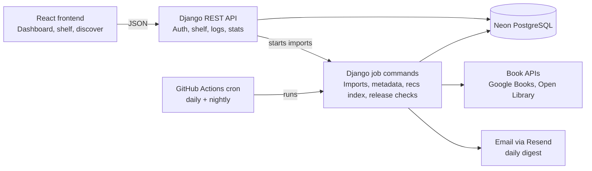

# Shelfwise PRD

Nov 16, 2026 · @jodi

## Overview

Shelfwise is one web app that tracks what you read, recommends what to read next, and alerts you when authors you love release new books. Each feature feeds the next: logging and rating books powers the recommendations and decides which authors get watched.

**Problem.** Readers juggle a tracker, scattered recommendation lists, and manual checks for new releases. Goodreads, the default tool, closed its public API in December 2020, so personal tools can no longer build on its data.

**Product loop.** Read → log pages and rate → get recommendations and release alerts → add to shelf → read.

**Scope.** Version 1 is a personal tool with one user: me. It doubles as a portfolio project, and a small public beta can come later once it works well for me.

## Goals and non-goals

The v1 goal is a deployed app I use every day, at $0 a month, that gives me a useful dashboard, recommendations and alerts within five minutes of importing my Goodreads library.

**Product goals**

- Make logging a reading session take under 15 seconds.
- Give useful recommendations from the first session, using a Goodreads CSV import to avoid a cold start.
- Alert users to new releases from authors they follow within 24 hours of the release appearing in Google Books or Open Library.

**Portfolio goals**

- Show full-stack architecture: React frontend, Django REST API, PostgreSQL.
- Show asynchronous background work with Celery and Redis.
- Show applied ML: content-based recommendations with TF-IDF and cosine similarity.
- Ship with Docker Compose, automated tests, CI and a public deployment.

**Non-goals for v1**

- Social features: friends, feeds, public reviews.
- Mobile apps (the web app should still be responsive).
- Scraping Goodreads or any bookstore site.
- Buying books or affiliate links.
- Collaborative filtering, which needs many users' ratings.

## Target users

Version 1 has one user: me. The personas below describe who a later public beta would serve and help decide what to build after v1.

| Persona | Who they are | What they need |
| --- | --- | --- |
| The goal-setter | Reads 20 to 50 books a year, sets yearly reading goals | Fast logging, progress charts, streaks |
| The series follower | Reads a few favorite authors, waits for sequels | Reliable release alerts, followed-author list |
| The Goodreads migrant | Has years of ratings on Goodreads | One-click CSV import that keeps ratings and shelves |
| The browser | Finishes a book and doesn't know what's next | Recommendations that explain why a book was suggested |

## User stories

**Tracking**

- As a reader, I can search for a book and add it to my shelf as Want to read, Reading, Finished or Did not finish (DNF).
- As a reader, I can log how many pages I read today in under 15 seconds.
- As a reader, I can rate a finished book from 1 to 5 stars and write a short review.
- As a reader, I can mark a book DNF with the page I stopped at and why, and pick it back up later if I change my mind.
- As a reader, I can see a book's series and its number, and view a series in reading order.
- As a reader, I can see charts of pages read per month, books finished per year, genre mix and rating distribution, with DNFs counted separately.

**Import**

- As a Goodreads user, I can upload my Goodreads export CSV and see my shelves and ratings appear in Shelfwise.
- As a Goodreads user, I can see which rows couldn't be matched and fix them by hand.

**Recommendations**

- As a reader, I see a list of personal recommendations based on books I rated 4 stars or higher.
- As a reader, books I DNF'd push similar books down my recommendations, more strongly when I stopped because of the writing or genre than because I wasn't in the mood.
- As a reader, I see the next book in a series I enjoyed near the top of my recommendations.
- As a reader, I can open any book and see "More like this."
- As a reader, I can see why a book was recommended, such as "Because you liked *The Martian*."
- As a reader, I can dismiss a recommendation or add it to my shelf in one click.

**Release alerts**

- As a reader, authors I rate 4 stars or higher are followed automatically, and I can follow or unfollow any author by hand.
- As a reader, I get one daily digest email listing new or upcoming books from authors I follow, plus any new book that continues a series I've finished.
- As a reader, I can see past alerts in the app and turn email alerts on or off.

## Functional requirements

P0 is the MVP (tracker and catalog). P1 completes the three-feature loop. P2 is polish after launch.

| ID | Module | Requirement | Priority |
| --- | --- | --- | --- |
| T-1 | Tracker | Email and password sign-up, login and JWT auth | P0 |
| T-2 | Tracker | Add, update and remove books on a shelf with status Want to read, Reading, Finished or Did not finish (DNF) | P0 |
| T-3 | Tracker | Log pages read per day per book; edit or delete a log | P0 |
| T-4 | Tracker | Rate 1 to 5 stars and write an optional review | P0 |
| T-5 | Tracker | Dashboard: pages per month, books per year, genre mix, rating distribution; DNF books count separately, not as finished | P0 |
| T-6 | Tracker | Marking a book DNF records the page I stopped at, the date, a reason (writing style, pacing, content, not my genre, not in the mood, other) and an optional note; a DNF book can be resumed later | P0 |
| C-1 | Catalog | Search books through Google Books, falling back to Open Library | P0 |
| C-2 | Catalog | Save title, authors, description, genres, page count, publish date and cover to the shared catalog when a book is first added | P0 |
| C-3 | Catalog | Seed the catalog from an Open Library data dump (target 10,000+ books) | P1 |
| C-4 | Catalog | Store an optional series name and number per book; fill from Open Library when available; editable by hand | P2 |
| I-1 | Import | Upload a Goodreads export CSV; match rows by ISBN, then by title plus author; map a custom shelf named "dnf" or "did-not-finish" to DNF | P1 |
| I-2 | Import | Run the import as a background job with a progress bar | P1 |
| I-3 | Import | Never import a row twice; re-running an import updates existing entries | P1 |
| I-4 | Import | Show unmatched rows and let the user search and match them by hand | P1 |
| R-1 | Recommendations | Nightly job builds TF-IDF vectors from description plus genres | P1 |
| R-2 | Recommendations | Personal list: top 20 unread books by similarity to the user's 4★+ books; never recommend a book already shelved or DNF'd | P1 |
| R-3 | Recommendations | "More like this" on each book page | P1 |
| R-4 | Recommendations | Show the reason ("Because you liked X"); let users dismiss a pick | P2 |
| R-5 | Recommendations | DNF books are a negative signal: score = similarity to liked books minus weighted similarity to DNF books. Reason sets the weight: writing style or not my genre = strong, pacing or content = medium, not in the mood = none | P1 |
| R-6 | Recommendations | Boost the next unread book in a series I finished and rated 3★ or higher; skip series I DNF'd | P2 |
| N-1 | Notifier | Auto-follow authors on a 4★+ rating, never from a DNF; follow or unfollow by hand | P1 |
| N-2 | Notifier | Daily job checks followed authors for titles published in the last 30 days or upcoming | P1 |
| N-3 | Notifier | Send one daily digest email (SMTP) listing that day's new releases; skip days with none; respect the email on/off setting | P1 |
| N-4 | Notifier | Never send the same alert twice to one user | P1 |
| N-5 | Notifier | In-app alert history and an unread badge | P2 |
| N-6 | Notifier | Option to switch the digest from daily to weekly | P2 |
| N-7 | Notifier | Digest flags "next in series" when a new book continues a series I've finished, even if I don't follow the author | P2 |

## Non-functional requirements

| Area | Requirement |
| --- | --- |
| Performance | API responses under 300 ms at p95 for shelf, logs and stats; recommendations come from precomputed scores, never computed per request |
| External APIs | Cache Google Books responses; respect rate limits with backoff; never call an external API inside a user request when a background job can do it |
| Reliability | Background jobs retry up to 3 times with backoff; a failed alert is logged and retried, never silently dropped |
| Security | Hashed passwords, JWT with short expiry, per-user data isolation on every query, secrets only in environment variables |
| Privacy | Uploaded CSVs are deleted after import; users can export and delete all their data |
| Compliance | Use only official APIs and data dumps (Google Books, Open Library); no scraping; follow each API's terms and show attribution |
| Quality | 70%+ backend test coverage; CI runs lint and tests on every push |
| Accessibility | Keyboard-navigable UI; charts have text alternatives; WCAG AA color contrast |

## System architecture

The API answers user requests from the database only; every slow or external call runs as a scheduled job.

Scheduled jobs handle metadata lookups for new books, the nightly recommendation rebuild and the daily release check. A Goodreads import runs as a one-off job when I upload a CSV.

**Data model.** Nine tables: `users`, `books`, `authors`, `book_authors`, `user_books` (status including DNF, rating, review, plus DNF page, reason and note), `reading_logs`, `followed_authors` (with source: manual or auto), `recommendations` and `notifications` (unique on user plus book). The books table also stores an optional series name and number.

**Tech stack.** React and Vite, Chart.js, Django REST Framework, PostgreSQL, Celery with Redis (local development only), scikit-learn, Docker Compose, GitHub Actions (CI and scheduled jobs).

**External dependencies.** Google Books API (search and metadata), Open Library API and data dumps (metadata, catalog seed, author works), and an SMTP email provider. Alerts go through a channel interface, so Discord or Slack can be added later as an optional P2 channel.

## Hosting and cost

Version 1 runs for $0 a month by replacing the always-on Celery worker with scheduled GitHub Actions runs.

| Component | Service | Cost |
| --- | --- | --- |
| Frontend | Render static site | $0 |
| Django API | Render free web service (sleeps after 15 minutes idle) | $0 |
| Database | Neon free Postgres (1 GB storage, 100 compute hours a month) | $0 |
| Scheduled jobs | GitHub Actions cron running Django management commands | $0 on a public repo |
| Email | Resend free plan: 3,000 emails a month, 100 a day | $0 |
| Book data | Google Books (1,000 requests a day) and Open Library | $0 |
| Domain | Optional; needed to email anyone other than me | About $10 to $15 a year |

- **Job schedule:** release check daily at 6am Pacific; recommendation rebuild nightly at 2am Pacific.
- **Same code in both setups:** jobs are plain Django management commands. Locally, Celery and Redis in Docker Compose run them; in production, GitHub Actions does. Moving to a paid worker later is a config change.
- **Trade-offs I accept for v1:** a slow first load after the API sleeps, and alerts that can arrive up to a day late.
- **Risk:** free-tier limits change often, so recheck them before launch.

## Success metrics

These are targets for my own use in the first month after launch. They're also good numbers to quote on a resume.

| Metric | Target |
| --- | --- |
| Days I log reading | 5+ days a week for 4 weeks |
| Goodreads import match rate on my own export | 90%+ of rows matched automatically |
| Recommendations I add to my shelf | At least 1 in 5 shown picks |
| Release alerts delivered within 24 hours of the title appearing in the source API | 95%+ |
| Duplicate alerts sent | 0 |
| Monthly hosting cost | $0 |
| p95 API latency (excluding cold starts) | Under 300 ms |

## Milestones

The plan has five phases over roughly 9 to 11 weeks of part-time work, and each phase ends with a deployed, working app.

| Phase | Est. | Scope | Gate |
| --- | --- | --- | --- |
| 1. MVP tracker (P0) | ~3 wks | Auth, search, shelf with DNF, page logs, ratings, dashboard | Deployed publicly and used daily for a week |
| 2. Goodreads import (P1) | 1-2 wks | CSV upload, matching, progress bar, unmatched-row fixes | 90%+ of my own export matches automatically |
| 3. Recommendations (P1) | ~2 wks | Catalog seed, TF-IDF index, personal picks, more like this | Picks look sensible for 3 test reader profiles |
| 4. Release alerts (P1) | ~2 wks | Auto-follow, daily check, daily digest email, history | Zero duplicate alerts over a week of runs |
| 5. Polish (P2) | 1-2 wks | More tests, coverage, explanations, README, a month of use | Success metrics measured and written up |

Durations are estimates for one developer working part-time. Don't start a phase until the previous phase's gate is met.

## Risks and open questions

| Risk | Impact | Mitigation |
| --- | --- | --- |
| Google Books metadata is incomplete (missing descriptions or genres) | Weak recommendations for some books | Merge with Open Library data; skip books with no text from scoring |
| Release dates in APIs are late or wrong | Missed or early alerts | Check both sources; treat a new title as the trigger, not just its date |
| API rate limits during large imports | Slow imports, failed lookups | Queue lookups with throttling; cache results; retry with backoff |
| Same book appears as several editions | Duplicate shelf entries and recommendations | Group editions by normalized title plus author; prefer ISBN-13 |
| TF-IDF misses tone and style | Recommendations feel generic | Start with TF-IDF, then compare sentence embeddings in a notebook |
| Scope creep | MVP never ships | Ship P0 first and deploy it before starting P1 |

**Open questions**

- [ ] How large should the seeded catalog be to give good recommendations without slow nightly rebuilds?

**Decisions**

- **Backend: Django.** Built-in auth, admin and ORM, plus Django REST Framework for the API.
- **Database: Neon free Postgres.** Plain Postgres that scales to zero when idle and wakes on the next query; no Supabase extras (auth, storage) needed since Django covers them.
- **Alerts: one daily digest email.** New releases found that day are batched into a single email; no email is sent on days with nothing new.
- **Series: stored on each book (P2).** Optional name and number, filled from Open Library when available and editable by hand, since API series data is incomplete.
- **DNF: a fifth shelf status with a reason.** The reason controls how much a DNF lowers similar books in recommendations. Weights are fixed in v1 (writing style or not my genre 1.0, pacing or content 0.5, not in the mood 0) and live in a settings file I can tweak; learning them from my later ratings is a future upgrade once I have a year of history.
